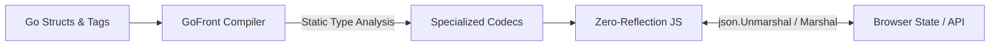

Ten days after [GoFront 1.6](/blog/2026-10-10-gofront-1-6-release) expanded our WebAssembly runtime, GoFront 1.7 lands today with a focus on frontend ergonomics: bringing standard Go data serialization to the browser without reflection overhead, and unlocking seamless component integration with Preact.



## Reflection-Free Compile-Time `encoding/json`

In standard Go, `encoding/json` relies heavily on runtime reflection (`reflect.ValueOf`, `reflect.TypeOf`). In a frontend compiler emitting lightweight JavaScript, shipping a full reflection engine is a non-starter: it inflates bundle sizes and hurts runtime performance.

GoFront 1.7 introduces static compile-time code generation for `encoding/json` in `js` packages:

- **Go Struct Tags**: supports `json:"fieldName"`, `,omitempty`, and `,string` (encoding/decoding numbers and booleans as JSON strings). Unexported lowercase struct fields are ignored.
- **Embedded Struct Promotion**: fields in embedded structs promote with standard Go shallow priority rules (conflicts at the same depth cancel each other).
- **Custom Marshaling**: honors `MarshalJSON() ([]byte, error)` and `UnmarshalJSON([]byte) error` methods with Go's value vs pointer receiver semantics.
- **Zero Runtime Reflection**: the compiler inspects struct types at build time and generates specialized, monomorphic codecs for each target type.

```go
type Project struct {
    ID    string   `json:"id"`
    Title string   `json:"title"`
    Tags  []string `json:"tags,omitempty"`
}

var payload ContentPayload
if err := json.Unmarshal(bytes, &payload); err != nil {
    return err
}
```

We immediately dogfooded this in this portfolio website: replacing loose browser `JSON.parse` and manual map unpacking with type-safe, compile-time `json.Unmarshal`.

## TypeScript Tuples and Preact Hooks

Interfacing with JavaScript libraries that return tuples—especially React and Preact hooks like `useState`—was previously awkward.

GoFront's `.d.ts` parser now recognizes TypeScript tuple return signatures `[T, Dispatch<T>]` and maps them directly to Go multi-value returns `(T, Dispatch)`. The compiler lowers this directly to JavaScript array destructuring:

```go
package main

import (
    "gofront/preact"
    "gofront/preact/hooks"
)

func Counter() preact.VNode {
    count, setCount := hooks.UseState(0)

    return preact.H("button", preact.Props{
        "onClick": func() { setCount(count + 1) },
    }, "Count: ", count)
}
```

The new `example/preact` directory in the repository demonstrates a complete TodoMVC application built with Preact functional components, hooks, and Go struct props.

## Experimental WASM SIMD (`gofront/simd`)

For compute-heavy WebAssembly workloads like physics engines and particle systems, GoFront 1.7 introduces experimental 128-bit vector support via `gofront/simd`:

- **4-Wide 32-bit Float Vectors**: `simd.F32x4` with value semantics (`Add`, `Sub`, `Mul`, `Div`, `Dot3`, `Dot4`, `Min`, `Max`).
- **Zero-Copy Memory Access**: `simd.LoadF32x4` and `simd.StoreF32x4` operate directly over `shared.Float32` linear memory buffers.
- **WASM SIMD Opcodes**: emits native `0xFD` vector opcodes, fully integrated with Binaryen's `--enable-simd` release pipeline.
- **Safe Fallback**: `js` packages provide bit-identical scalar fallbacks using `Math.fround`.

Initial raycast benchmarks in [SimpleFPS](/project/simplefps) showed a modest 1.02× speedup over the scalar hybrid pipeline, so full promotion out of experimental status is deferred while we refine memory layout optimizations for v1.8.0.

## Type System Hardening

We also ironed out several edge cases in the JavaScript backend:

- **Named Non-Struct Types with Methods**: types like `type Celsius float64` or `type Names []string` now remain raw primitive values throughout JS codegen. Methods dispatch statically without object wrapping overhead.
- **Dynamic Interface Type Assertions**: assertions like `v.(Stringer)` now verify method set conformance at runtime instead of unconditionally succeeding.
- **Multiple Address-Taken Declarations**: fixed tuple assignments where variables had their addresses taken (`a, b := 1, 2; &a`).
- **Underlying Type Assignability**: assignments like `var n Names = []string{...}` now properly conform to Go assignment rules for identical underlying types.

## Upgrading

```bash
npm install gofront@1.7.0
```

Both `simplefps` and this website are now running on GoFront 1.7.0 in production. Check out the [full changelog](https://github.com/seriva/gofront/blob/master/CHANGELOG.md) on GitHub!
