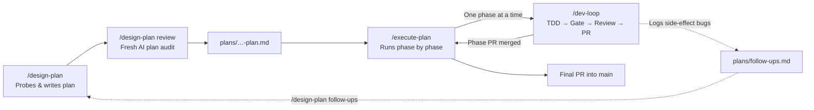
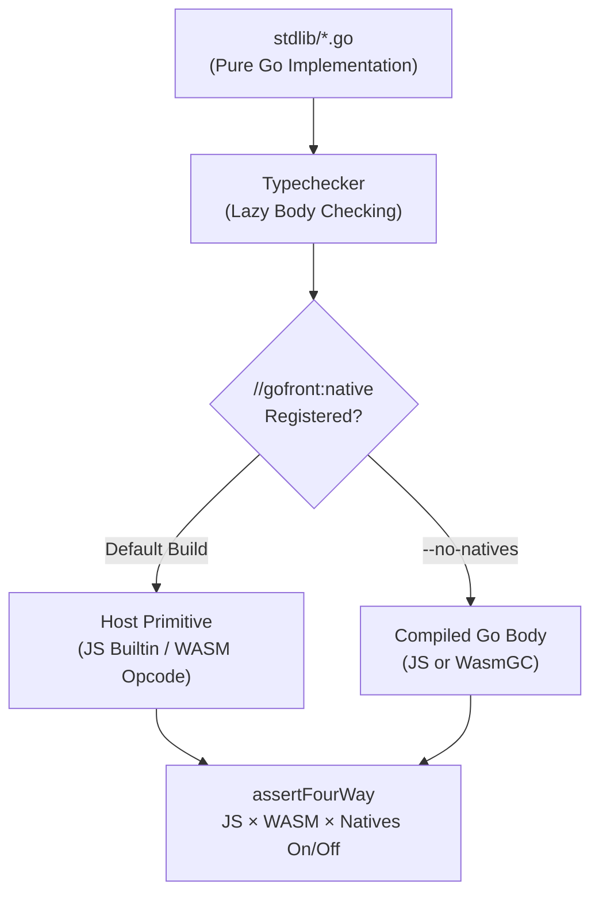

In September I wrote about [Bootstrapping Agentic Development](/blog/2026-09-21-bootstrapping-agentic-development): a shared `AGENTS.md` rulebook, docs-first plans, TDD and [Lefthook](https://github.com/evilmartians/lefthook) quality gates.

The workflow was already there, but I was still the one driving it. I kicked off each plan, started every phase, reviewed each diff and kept track of side-effect bugs myself.

Since then, [Bootstrap](/project/bootstrap) has taken over that driving as well. The whole cycle from plan to merged PR now runs agentically, and [GoFront](/project/gofront) 1.8 and 1.9 have been its proving ground.



## The Three-Skill Loop

Bootstrap turns each step of the workflow into a skill that agents can run end to end, and chains them together. The skills work across Claude Code, Google Antigravity, Codex, OpenCode, Pi and Cursor.

1. **`/design-plan`: probe before you build**  
   Agents shouldn't guess how complex code behaves from reading it. `/design-plan` starts with small probe scripts in `.probes/` that run against the compiler and `go run`, and records the results in a **Verified Gaps** table. It then sets hard scope boundaries and splits the work into small, atomic phases. Before any code is written, `/design-plan review` hands the draft to a fresh reviewer agent, which checks the probe claims, task sizes and dependencies against the codebase until it signs off with `PLAN_LGTM`.

2. **`/dev-loop`: TDD and fresh-context review**  
   Every phase or standalone task runs through the same loop: write a failing test, implement the minimal code to pass it, run the pre-commit gates (Biome, `gofront check` and [Sentrux](https://github.com/sentrux/sentrux) architecture rules) and push a draft PR. A **fresh-context reviewer** then audits the diff with no author bias. With `--pairing` that reviewer can be a different model, for example Claude implementing and Antigravity reviewing.

3. **`/execute-plan` and the follow-up ledger**  
   `/execute-plan` drives a multi-phase feature branch, running `/dev-loop` for each phase and ticking off the plan's checklist. Out-of-scope bugs found during review go into `plans/follow-ups.md` instead of derailing the current PR. Before the final merge into `main`, it audits the whole branch against the original plan.

I also keep a strict split between audiences: `README.md`, `docs/` and `CHANGELOG.md` are plain prose for humans, while `plans/` stays dense and written for agents.

## Running It in a Container

Autonomous runs only pay off if they can keep going while I do something else, so Bootstrap ships a ready-to-run agent server in `docker/`. One container bundles:

- **T3 Code** as the web orchestrator for starting and following agent sessions.
- **code-server**, VS Code in the browser, for reading diffs or stepping in when needed.
- **Worker CLIs** (Claude Code, Codex, OpenCode, Pi and Antigravity), picked with `ENABLED_WORKERS`, with the Bootstrap skills pre-installed.

```bash
cd bootstrap/docker
cp .env.example .env   # set PASSWORD
docker compose up -d
docker compose exec agent t3-pair
```

`t3-pair` prints a pairing link, so I can open T3 Code on my laptop or phone, start an `/execute-plan --auto` run and check in on it later.

Isolation is the other reason. Paired reviews run headless reviewer CLIs without interactive permission prompts, which I'd rather not allow on my own machine. Inside the container, agents only see the mounted workspace, and the logins for the worker CLIs, the GitHub CLI and SSH live in volumes that survive rebuilds. Both web UIs bind to `127.0.0.1` by default, and the container refuses to start without a password, since code-server hands out a shell with passwordless sudo.

On my homelab, a thin layer on top of the Bootstrap image adds Go, Playwright and Sentrux for GoFront's toolchain. A scheduled job upgrades the worker CLIs in place, and a rebuild script pulls the latest Bootstrap and rebuilds both images from scratch. That box is where most of the GoFront work below actually ran.

## GoFront 1.8 and 1.9: Groundwork for 2.0

I used this loop for most of the work in GoFront 1.8 and 1.9. Next to new features like Go 1.23 iterators, compile-time JSON for WASM and test benchmarks, both releases are largely groundwork for 2.0, where the compiler core gets rewritten in native Go.

The biggest obstacle to that rewrite was the standard library. GoFront emulated it with **32,752 lines of hand-written JavaScript** inside the compiler, 26,460 of which were bespoke WASM emitters, against just 5,455 lines of actual Go. All of that would have had to be ported, and the probes showed it wasn't great code to port either:

- WASM sorting was quadratic: sorting 200,000 `int`s took **over 20 seconds**.
- Comparators mishandled `NaN` and broke ties differently from Go's `pdqsort`.
- Generic helpers rejected named types like `type IDs []int`, and 64-bit integers in JS lost precision above 2⁵³.

So the plan flipped it around: **the Go source in `stdlib/` is the specification and the default implementation.** A host native (a JS builtin or WASM opcode) only replaces it when it is measurably faster, and a four-way test checks that JS and WASM, with natives on and off, all agree.



The agents ran the migration as a 13-phase plan:

- 19 standard library packages moved to pure Go in `stdlib/`.
- `int64` and `uint64` became exact `BigInt`s in JS output.
- WASM `slices.Sort` on 200,000 items dropped from **20,443 ms to 38 ms**, more than 500× faster.
- About **18,500 lines** of WASM emitters were deleted.

Follow-up plans moved `strings.Builder`, `math` and the runtime overlays (`os`, `unicode`, `regexp`, `testing` and friends) into Go as well, and replaced the separate JS and WASM JSON emitters with one shared pipeline that halved decode times. `strings.Builder` alone went from about 850 lines of emitters to 90 lines of Go. By the time 1.9.0 is tagged, **over 28,000 lines** of bespoke emitters and shims will be gone from the compiler, and 2.0 can simply embed `stdlib/` and compile it like any other code.

## Clearing 202 Follow-Ups in 27 Phases

The follow-up ledger proved its worth too. The reviewers were picky, and by early November `plans/follow-ups.md` held over 200 small divergences from `go run`, from name-mangling collisions in the JS backend to labelled `break` across nested switches in WASM.

One `/design-plan follow-ups` run probed every entry across the `js`, `wasm` and `both` targets, confirmed **202 real defects**, grouped them by subsystem and drafted a 27-phase plan. `/execute-plan --auto` then worked through 27 branches, 27 fresh reviews and 27 merged PRs, and cleared the whole ledger without me triaging a single entry.

---

With the standard library in Go and [Sentrux](https://github.com/sentrux/sentrux) guarding the architecture, the way is clear for the native Go rewrite in 2.0, and Bootstrap will be doing most of the driving there as well.

Try [Bootstrap](https://github.com/seriva/bootstrap) on your own projects, follow [GoFront](https://github.com/seriva/gofront) on GitHub, and let me know how it goes.
