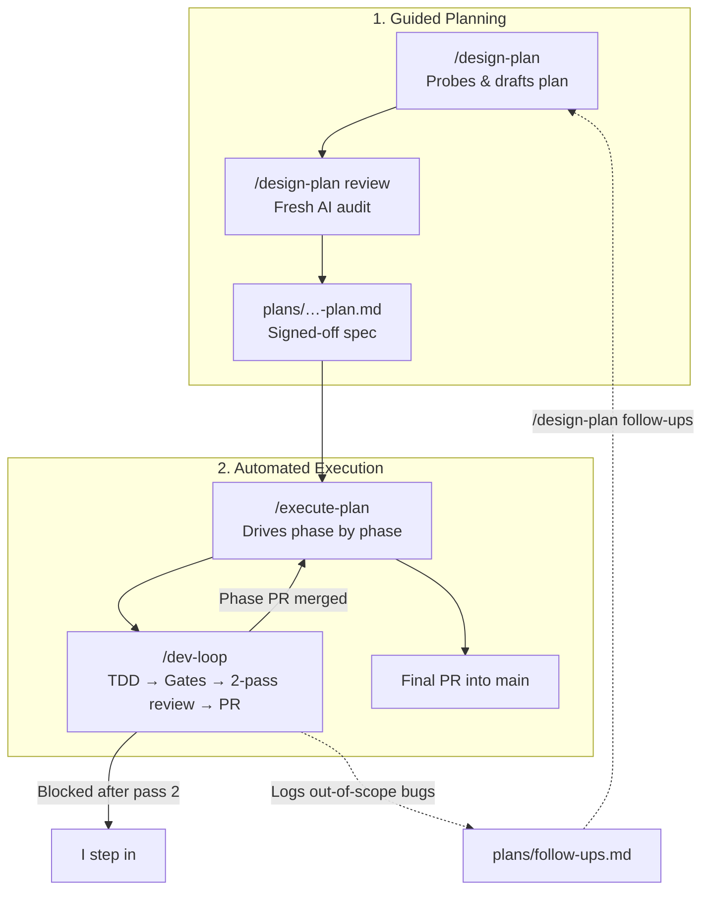
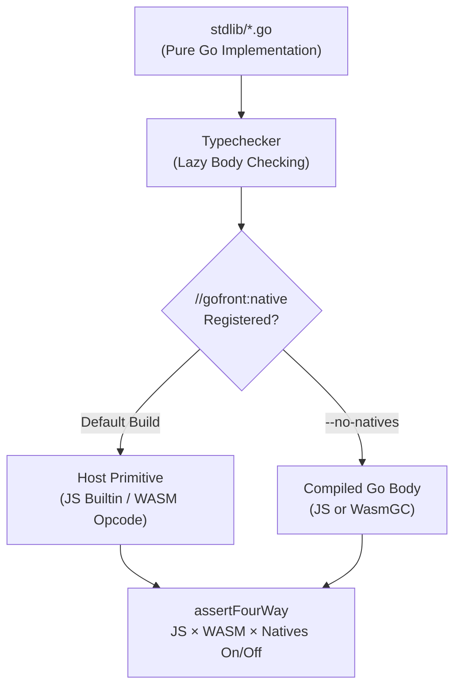

In September I wrote about [Bootstrapping Agentic Development](/blog/2026-09-21-bootstrapping-agentic-development): a shared `AGENTS.md`, plans before code, TDD, and [Lefthook](https://github.com/evilmartians/lefthook) checks. It worked, but I still had to start every phase and review myself.

Now [Bootstrap](/project/bootstrap) does everything after the plan. I help with the planning, because that's where the real decisions are. After that I step away, and it runs until the final merge. I tested this on [GoFront](/project/gofront) 1.8 and 1.9.



## Three Skills

Bootstrap has three skills. They work in Claude Code, Antigravity, Codex, OpenCode, Pi, and Cursor.

**`/design-plan`** writes the plan. Instead of guessing how the code behaves, it writes small probe scripts and runs them. Then it splits the work into small phases. I steer while it drafts. A fresh agent reviews the plan before any code is written.

**`/dev-loop`** builds one phase: failing test, code, pre-commit checks (Biome, `gofront check`, [Sentrux](https://github.com/sentrux/sentrux)), and a PR. Then two reviews:

- A fresh reviewer checks the PR. If it finds real problems, the author gets one chance to fix them.
- A second reviewer checks only the fixes, and either approves or blocks.

There's no third round. If it's blocked, I take over. With `--pairing`, one model can write the code and another can review it.

**`/execute-plan`** runs all the phases in order without waiting for me. Bugs found outside the current phase go into `plans/follow-ups.md` instead of the PR. At the end it checks the whole branch against the plan before merging into `main`.

## Running It in a Container

Bootstrap comes with a Docker setup in `docker/`. It has T3 Code to start and watch runs from my phone, code-server for looking at diffs, and the agent CLIs.

```bash
cd bootstrap/docker
cp .env.example .env   # set PASSWORD
docker compose up -d
docker compose exec agent t3-pair
```

I run one plan at a time, usually overnight. That's plenty, and the git history stays easy to follow. The reviewers run without permission prompts, so the container only sees the project it works on, and the web UIs are only on `127.0.0.1` behind a password.

On my homelab I add Go, Playwright, and Sentrux on top. That's where most of the GoFront work ran.

## GoFront 1.8 and 1.9

Besides Go 1.23 iterators and compile-time JSON, these releases prepare for 2.0, where the compiler gets rewritten in Go.

The big problem was the standard library. It was **32,752 lines of hand-written JavaScript**, against only 5,455 lines of Go. The probes found real bugs:

- Sorting 200,000 integers in WASM took **over 20 seconds**.
- Sorting handled `NaN` and ties differently than Go.
- Generic helpers broke on named types, and 64-bit integers lost precision in JavaScript.

So we flipped it: **the standard library is now plain Go in `stdlib/`.** A faster JS or WASM version is only used when it's measurably faster and gives the same results.



Results:

- 19 packages moved to plain Go.
- Sorting 200,000 items in WASM went from **20,443 ms to 38 ms**.
- By the 1.9.0 release, **over 28,000 lines** of hand-written JavaScript will be gone.

## 264 Bugs, 36 Phases

The reviews kept finding cases where GoFront behaved differently from `go run`. For 1.9 I ran `/design-plan follow-ups` twice. The first run confirmed **202 real bugs** and turned them into a 27-phase plan. Fixing those turned up more, so a second run planned **62 more** in 9 phases. Each time I checked the order, then `/execute-plan --auto` did the rest: 36 PRs, all reviewed and merged, without me.

---

GoFront is now ready for 2.0. I'll keep doing the planning and let Bootstrap do the rest.

[Bootstrap](https://github.com/seriva/bootstrap) and [GoFront](https://github.com/seriva/gofront) are both on GitHub. Let me know what you think.
